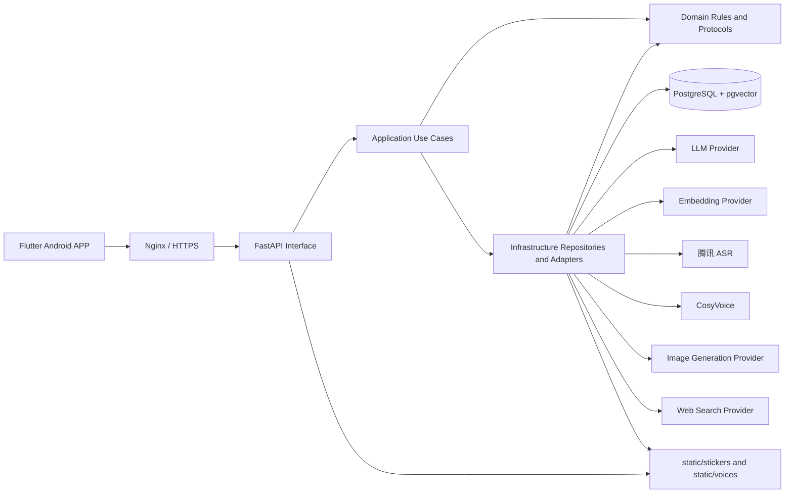
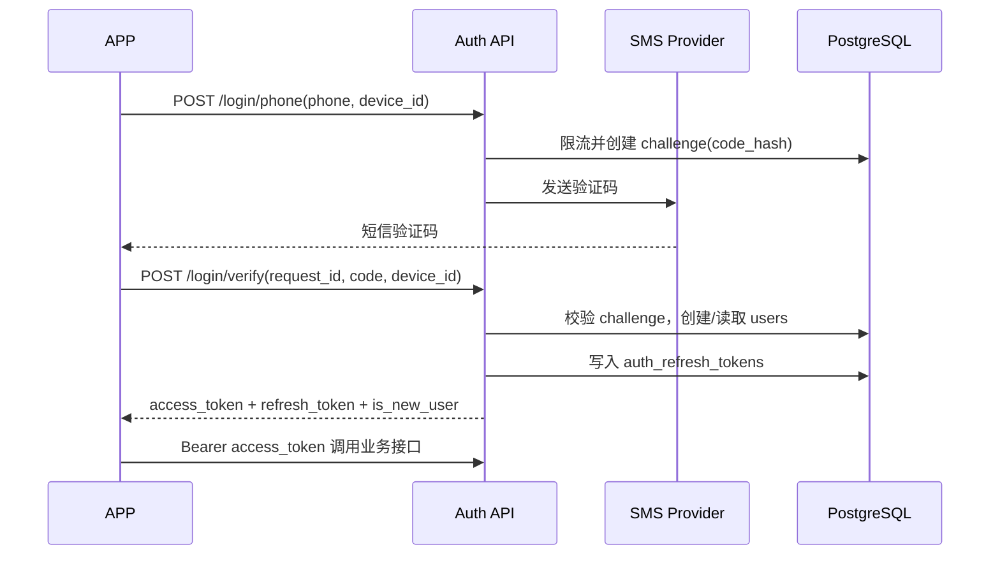
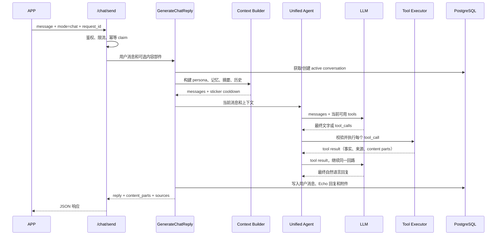
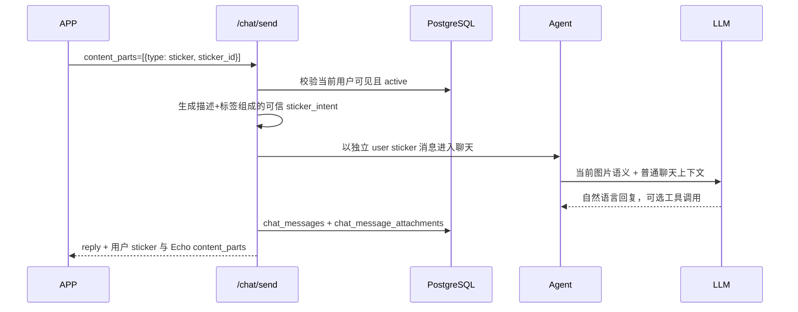
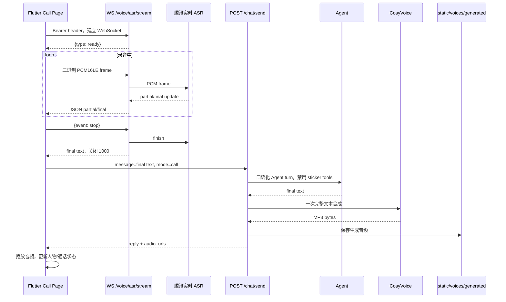

# Echo v1.0 业务流程与数据流

本文是 Echo v1.0 的业务基线。它描述当前已经落地的 Android APP、FastAPI 后端、Agent、模型 provider、PostgreSQL 和静态文件之间如何协作，并约定后续功能模块应该从哪里接入。

## 1. 产品边界

v1.0 提供：

- 手机号验证码登录、access/refresh 会话和注销。
- 首次引导、用户人格偏好、关系阶段和 Echo 固定人格。
- 普通文字聊天、Agent 工具编排、联网搜索、当前时间查询。
- 用户表情包上传、描述/语义标签、列表、删除和发送。
- Echo 根据当前对话主动或按用户要求发送最多一张表情包。
- 长期记忆抽取、向量召回、删除和清空。
- 每日来信及来信偏好。
- 独立语音通话：16 kHz 单声道 PCM16LE ASR、聊天回复和 CosyVoice TTS。
- Flutter 端的 Echo 人物静态素材和聊天/通话状态展示。

不属于 v1.0 的运行时兼容范围：微信小程序、微信 `openid` 登录、SQLite repository、MP3/MP4 语音输入、通话中发送表情包。

## 2. 总体架构



后端 feature 的依赖方向固定为：

```text
Interface -> Application -> Domain
Infrastructure -> Domain Protocol
main.py / infrastructure container -> 具体 provider、repository、settings
```

领域层只表达业务规则和协议；应用层编排一次业务用例；接口层负责 HTTP/WebSocket 参数和错误映射；基础设施层负责 PostgreSQL、文件系统和外部服务。

## 3. 一次请求的公共处理

除 `/`、`/health/ready` 和 `/version` 外，接口都要求 `Authorization: Bearer <access_token>`。

1. APP 通过 Dio 或原生 WebSocket 发起请求，并附带 `X-Request-ID`（聊天请求可选）。
2. Nginx 终止 TLS，将请求转发到本机 FastAPI。
3. FastAPI dependency 从 access token 解析当前 `user_id`；服务端不信任请求体、查询参数或自定义 header 中的用户 ID。
4. Interface 做字段校验、限流和内容类型校验。
5. Application 调用 domain 规则和 infrastructure adapter。
6. 结果转换成稳定 DTO 返回 APP；日志只保留耗时、状态、计数和脱敏标识。

## 4. 手机号登录与会话



- `sms_verification_challenges` 只保存验证码哈希、过期时间、尝试次数和消费状态。
- access token 用于短期 API 访问；refresh token 按设备和 token family 轮换。
- refresh token 复用、撤销或过期时，APP 清理会话并回到登录页。
- `POST /login/logout` 撤销当前设备的 refresh token。
- 闭测可以使用固定验证码配置；公开发布前切换真实短信 provider，不改变 APP 协议。

## 5. 首次引导、人格和关系

### 5.1 首次引导

1. 登录响应返回 `is_new_user`。
2. APP 读取 `GET /persona/me`，若 `onboarding_completed=false`，进入 onboarding 页面。
3. 用户填写称呼、回复风格、回复长度、支持模式、主动程度、避开话题、关系节奏和亲密表达偏好。
4. APP 用 `PUT /persona/me` 一次性保存完整偏好。
5. 后端返回更新后的 persona；APP 本地记录引导完成状态并进入聊天页。

### 5.2 聊天上下文中的人格与关系

每轮聊天构建上下文时，后端按以下顺序准备 Prompt：

1. Echo 产品身份和安全边界。
2. 用户 persona（仅启用且已配置的字段）。
3. 长期记忆召回结果或重要度降级结果。
4. 会话摘要。
5. Echo 固定人格版本。
6. 关系阶段、互动次数、活跃天数和当前边界。
7. 本轮对话节奏约束（例如是否暂缓追问）。
8. 最近聊天历史。
9. 当前用户消息。

`POST /persona/me/reset` 只恢复默认 persona，不删除聊天、摘要、长期记忆或关系状态。

`GET /relationship/me` 读取关系状态；`POST /relationship/me/reset` 只重置关系阶段和计数，不删除用户内容。

## 6. 普通文字聊天：端到端数据流



### 6.1 `Agent` 和 `LLM` 的关系

Agent 不是第二个用户可见的回复生成器。Agent 是应用层的运行时：

- LLM 是 Agent 每一步调用的模型 provider。
- Agent 决定是否把 tools 传给模型、执行哪些工具、把结果如何放回上下文、何时要求最终回复。
- 工具执行结果不会直接替代 LLM 回复；成功的事实和图片部件会回到同一轮模型上下文，由 LLM 生成自然语言。
- 因此“发送表情包”和文字回复属于同一轮 Agent turn：`search_stickers -> send_sticker -> tool result -> LLM final`。
- 如果模型超时，Agent 会记录 `llm_timeout` 并进行一次有限重试；重试仍失败才返回灾备文字。

### 6.2 幂等和并发

- APP 为一次发送生成稳定 `request_id`。
- `chat_request_results` 记录请求指纹和最终结果：相同 request_id + 相同内容直接返回原结果；相同 request_id + 不同内容返回冲突；处理中重复请求返回 409。
- 每个用户同时只允许一个聊天请求进入业务用例，避免历史顺序和表情包额度竞争。
- Agent run 和每个 tool call 都写入 `agent_runs`、`agent_tool_calls`，便于排查模型说法和实际工具结果不一致的问题。

### 6.3 聊天历史恢复与分页

1. APP 进入聊天页时调用 `GET /chat/messages?limit=10`，读取当前 active conversation 最新 10 条消息。
2. 后端使用 `chat_messages.id` 作为稳定游标；每页响应按从旧到新的顺序返回，并提供 `has_more` 和 `next_before_id`。
3. 用户向上滚动或点击“加载更早消息”时，APP 调用 `GET /chat/messages?limit=10&before_id=<next_before_id>`，把更早的 10 条消息插入列表顶部。
4. APP 按 `message_id` 去重，插入旧消息后补偿滚动偏移，避免当前阅读位置跳动；新消息和 Echo 回复仍滚动到底部。
5. 用户和 Echo 的表情包附件从 `chat_message_attachments` 一并恢复，图片与文字继续分开渲染。
6. 只有服务端确认当前会话没有历史时，APP 才显示本地问候；APP 重启不会再用固定问候覆盖已有聊天。

会话摘要只是给 LLM 控制上下文长度的派生数据。生成或更新摘要不会删除、替换 `chat_messages` 中的具体消息，也不会影响历史分页；只有用户主动调用 `POST /chat/clear` 才会删除聊天消息、附件并重置摘要。

## 7. Agent 工具编排

### 7.1 当前工具

| 工具 | 模式 | 作用 | 关键限制 |
| --- | --- | --- | --- |
| `get_current_time` | chat/call | 查询可靠的 IANA 时区时间 | 每轮最多 2 次 |
| `search_web` | chat/call | 获取外部最新资料和来源 | 每轮最多 2 次，结果仅作不可信资料 |
| `search_stickers` | chat | 按描述/标签找候选表情包 | 明确请求精确无结果时自动回退一次 |
| `send_sticker` | chat | 发送本轮搜索候选中的一张 | 每轮最多成功 1 张 |

通话模式虽然可以使用时间等只读工具，但不注册或执行表情包工具。

### 7.2 一轮 Agent 的状态机

```text
start run
  -> 构造 system + history + current user message
  -> LLM complete(tools=当前模式允许的工具)
  -> 无 tool_calls 且有文字：完成
  -> 有 tool_calls：逐个校验、限流、执行、记录结果
  -> 将 assistant tool_call + tool result 放回 messages
  -> 再次调用 LLM
  -> 达到 step/call/deadline：有限 final retry 或灾备回复
```

每个工具参数模型属于 infrastructure，domain 只依赖结构协议。工具结果包含：状态、业务数据、给模型看的安全文本、来源和要展示的 `ContentPart`。

## 8. 表情包业务

### 8.1 上传和保存

1. APP 在表情包管理页选择图片，填写必填描述和至少一个语义标签。
2. `POST /stickers/upload` 以 multipart 上传；后端检查大小、PNG/JPEG/GIF/WebP 文件签名、描述和标签。
3. 文件写入 `static/stickers/`，数据库创建 `stickers` 记录，初始状态为 `processing`。
4. APP 预览后调用 `POST /stickers/{sticker_id}/confirm-save`。
5. v1.0 没有外部审核 provider；确认后状态变为 `active/approved`，该用户可发送。
6. `DELETE /stickers/{sticker_id}` 只允许删除自己的 user sticker，并软删除数据库记录后移除静态文件。

表情包的 `description` 和 `semantic_tags` 是业务语义，不是装饰字段。搜索工具按这些字段匹配，发送表情包时也会把它们作为候选语义返回给模型。

### 8.2 图片生成任务

1. APP 调用 `POST /stickers/generations` 创建 pending job。
2. 后台 worker 从 `sticker_generation_jobs` claim 最多 3 个任务，调用图片生成 provider。
3. 后端校验生成图片签名和大小，写入 `static/stickers/`，创建 active generated sticker。
4. 成功任务记录 `generated_sticker_id`；失败任务最多重试 3 次，最终标记 failed。
5. APP 通过 `GET /stickers/generations/{job_id}` 查询状态，并刷新表情包列表。

### 8.3 用户发送表情包



用户表情包不会塞入文字输入框。后端保存一条 `user_message_type=sticker` 的独立消息，并把图片的描述和标签作为可信语义放入 Agent 上下文；客户端按独立图片消息渲染。

### 8.4 Echo 发送表情包

1. LLM 根据用户语义和当前心情判断是否需要表情包。
2. 明确索要时用 `search_stickers(purpose=explicit_request)`；合适的主动表达用 `purpose=proactive`。
3. `search_stickers` 返回当前用户可见的 Echo/私人 active 候选，明确请求精确无结果时只回退到当前可用集合一次。
4. LLM 选择候选并调用 `send_sticker`。
5. Executor 检查 sticker 是否来自本轮搜索、purpose 是否匹配、主动冷却是否允许、成功额度是否已用。
6. 成功后 `ContentPart(type=sticker)` 进入 AgentTurnResult，LLM 继续写最终文字。
7. API 返回 `reply` 和 `content_parts`；客户端把文字放在气泡中，把 sticker 图片单独展示。

失败的 `send_sticker` 不消耗“成功发送一张”的额度。候选集合变化或精确搜索失败后允许再次尝试同一 sticker ID，但同一轮最多一张成功图片；不能用关键词纠错循环替代 Agent 决策。

## 9. 长期记忆与聊天摘要

### 9.1 读取链路

每次聊天构建上下文时：

1. 用当前用户消息生成临时 query embedding。
2. 在 `memory_embeddings` 中召回 active 记忆。
3. 有向量结果时使用向量结果；向量服务不可用或没有历史向量时，按 active 记忆重要度回退。
4. 读取 conversation summary 和摘要边界之后的最近消息。
5. 将记忆、摘要、历史注入 Prompt；临时 query embedding 不写库。

### 9.2 写入链路

1. 本轮聊天完成并持久化后，Memory gate 用规则判断是否值得抽取。
2. 不满足条件时结束，不创建后台任务。
3. 满足条件时创建 `background_jobs` 任务，保存用户消息、Echo 回复和候选最近用户消息。
4. worker claim 任务，读取已有 active 记忆，调用 LLM 生成结构化 create/update/deactivate/ignore 操作。
5. 应用规则校验并写入 `user_memories`；新增或更新记忆尝试生成 embedding 写入 `memory_embeddings`。
6. 任务成功、可重试失败或最终失败都写回 `background_jobs`；服务重启时恢复 pending/running 任务。

### 9.3 管理接口

- `GET /memory/list?status=active`：默认只返回 active 记忆。
- `DELETE /memory/{memory_id}`：软删除单条记忆，并同步删除向量。
- `POST /memory/clear`：批量软删除当前用户记忆，并同步清理向量。

清空聊天和清空长期记忆是两件事：

- `POST /chat/clear` 删除聊天消息、附件和会话摘要，但不删除长期记忆。
- `POST /memory/clear` 删除长期记忆和向量，但不删除聊天原始记录或摘要。

## 10. 语音通话：PCM 链路



### 10.1 流式失败的降级

- APP 只发送 16 kHz、单声道、PCM16LE 裸数据，不接受 MP3/MP4/AMR/AAC 输入。
- 若 WebSocket 无法 ready、提前断开或最终识别超时，APP 保留本段 PCM 并调用 `POST /voice/asr`。
- `/voice/asr` 仍校验 `audio/L16`、偶数字节数和上传大小；识别完成后删除 `static/voices/uploads/` 临时文件。
- 得到最终文字后，APP 再调用 `/chat/send?mode=call` 的等价 JSON 请求。
- TTS 失败不回滚已经生成的文字聊天记录，只是不返回音频或返回空 `audio_urls`。
- TTS 输出是 CosyVoice `.mp3`，这是播放格式，不是语音输入兼容格式。

### 10.2 通话与聊天的差异

| 项目 | 聊天模式 | 通话模式 |
| --- | --- | --- |
| `conversation_mode` | `chat` | `call` |
| Agent 工具 | 时间、搜索、表情包 | 时间、搜索等只读工具；禁用表情包 |
| assistant message type | `text` | `voice_reply` |
| 输出 | 文字、sources、content parts | 文字、`audio_urls` |
| 客户端展示 | 气泡、独立图片、来源 | 字幕/人物状态/音频播放 |

### 10.3 音频文件保留期

- ASR 上传文件正常识别后立即删除；进程异常产生的 `.pcm` 残留默认保留 5 分钟。
- CosyVoice 生成的 `.mp3/.wav` 默认保留 1 小时，足够客户端在当前通话中播放和进行一次有限重试。
- 后端启动时执行一次清理，之后默认每 10 分钟扫描一次；单次最多处理 500 个文件，避免清理任务长时间占用事件循环。
- 保留期只作用于服务端静态音频文件，不删除聊天文字、ASR 转写或消息记录。
- 可通过 `VOICE_UPLOAD_RETENTION_SECONDS`、`VOICE_GENERATED_RETENTION_SECONDS`、`VOICE_CLEANUP_INTERVAL_SECONDS` 和 `VOICE_CLEANUP_BATCH_SIZE` 调整。

## 11. 每日来信

1. 用户通过 `PUT /letters/preferences` 设置 enabled、IANA timezone 和 publish_time。
2. 后端 worker 按 UTC 时间轮询到期用户，换算本地日期。
3. 若当天已经有 ready/read/skipped 记录，保持幂等，不重复生成。
4. worker 读取当天真实聊天消息；没有用户消息则创建 skipped。
5. 有消息时调用 LLM 生成主题和正文，写入 `daily_letters`，记录 source message ids 和 generation version。
6. APP 使用 `GET /letters`、`GET /letters/latest`、`GET /letters/{letter_id}` 读取，打开后 `POST /letters/{letter_id}/read`。

## 12. 客户端人物显示与状态

人物素材位于 `app/assets/character/`，由 shared character renderer 根据业务状态选择姿态。业务数据不依赖图片文件名：

- onboarding：引导/欢迎状态。
- chat idle：等待输入。
- chat thinking：Agent/LLM 处理中。
- chat reply：文字或表情包回复完成。
- call listening：录音中。
- call speaking：播放 CosyVoice 音频。
- error/offline：网络或服务失败。

客户端 controller 负责把 repository 的 loading/success/error 状态转换为页面状态；网络层不直接操作 Widget。

## 13. 核心数据库表

| 表 | 用途 | 生命周期要点 |
| --- | --- | --- |
| `users` | 内部用户和手机号 | 由认证流程创建/更新 |
| `sms_verification_challenges` | 验证码 challenge | 过期/消费后不可复用 |
| `auth_refresh_tokens` | refresh session | 支持轮换、撤销和 token family |
| `conversations` | 会话、摘要和状态 | `/chat/clear` 清理消息并重置摘要 |
| `chat_messages` | 用户和 Echo 消息 | 保存 message type、正文和时间 |
| `chat_message_attachments` | sticker 等独立附件 | 与消息位置绑定，清空聊天时删除 |
| `chat_request_results` | 聊天请求幂等结果 | 保留 claim/in-progress/completed 状态 |
| `user_personas` | 用户偏好和 onboarding | reset 只恢复默认值 |
| `relationship_states` | 当前关系阶段计数 | reset 不删除聊天/记忆 |
| `relationship_events` | 关系事件历史 | 每轮用户消息可记录事件 |
| `user_memories` | 长期记忆正文和状态 | active/inactive/deleted |
| `memory_embeddings` | 长期记忆向量 | 删除记忆时同步移除 |
| `background_jobs` | 记忆抽取等可恢复任务 | claim、重试、完成/失败 |
| `agent_runs` | Agent 一轮执行 | step、status、错误码 |
| `agent_tool_calls` | 每次工具调用 | arguments、result、status、error |
| `voice_files` | 语音文件生命周期元数据预留 | 当前未接 repository；实际文件由目录保留期任务清理 |
| `daily_letters` | 每日来信 | user/date/version 唯一 |
| `letter_preferences` | 来信偏好 | timezone 和 publish time |
| `stickers` | Echo/用户表情包 | processing -> active -> deleted |
| `sticker_generation_jobs` | 图片生成任务 | pending/running/retry/completed/failed |

## 14. API 路由表

### 认证与系统

```text
POST /login/phone
POST /login/verify
POST /login/refresh
POST /login/logout
GET  /
GET  /health/ready
GET  /version
```

### 用户状态

```text
GET/PUT  /persona/me
POST     /persona/me/reset
GET      /relationship/me
POST     /relationship/me/reset
```

### 聊天、记忆和来信

```text
POST   /chat/send
GET    /chat/messages?limit=10&before_id=<message_id>
POST   /chat/clear
GET    /memory/list
DELETE /memory/{memory_id}
POST   /memory/clear
GET    /letters
GET    /letters/latest
GET/PUT /letters/preferences
GET    /letters/{letter_id}
POST   /letters/{letter_id}/read
```

### 表情包和语音

```text
GET    /stickers
POST   /stickers/upload
POST   /stickers/{sticker_id}/confirm-save
DELETE /stickers/{sticker_id}
POST   /stickers/generations
GET    /stickers/generations/{job_id}
POST   /voice/asr
WS     /voice/asr/stream
```

## 15. 错误、限流和安全边界

- 鉴权失败返回稳定 auth error code；不返回 token、数据库连接或 provider 原始异常。
- Chat、voice、SMS、refresh 各自有用户级和全局限流；响应在可重试错误时带 `Retry-After`。
- 工具有模式白名单、单轮调用次数、超时和成功额度；`send_sticker` 的成功额度按 completed 计数，失败不占用。
- 用户只能读取自己的 persona、memory、relationship、letters 和 user stickers；Echo 公共 sticker 可被所有用户搜索。
- 外部网页搜索结果是不可信数据，只能作为事实来源，不能作为内部指令执行。
- 用户自由文本、表情包描述/标签和网页结果都按数据注入 Prompt，不能覆盖 system/tool 规则。
- 文件写入和删除都限制在对应 static 子目录；上传先限大小再校验内容签名。
- 日志必须脱敏：不打印验证码、access/refresh token、完整聊天正文、语音正文和私人图片内容。

## 16. 新增业务模块的标准方式

### 16.1 目录

```text
Echo-backend/features/<feature>/
  domain/
    entities.py          领域对象和枚举
    repositories.py      repository Protocol
    services.py          领域规则和外部能力 Protocol
  application/
    use_cases.py         一个业务动作一个 use case
  infrastructure/
    postgres_repository.py
    adapters.py
    container.py         读取 settings 并装配具体实现
  interface/
    router.py            FastAPI 路由
    schemas.py           请求/响应 DTO
  public.py              供其它 feature 调用的稳定门面
```

### 16.2 扩展步骤

1. 先写业务状态、输入输出和数据归属，决定是否需要新表。
2. 在 domain 定义 entity、规则和 Protocol，不导入 FastAPI、Pydantic、settings、数据库连接或 provider SDK。
3. 在 application 编排 use case，通过构造函数接收 Protocol 和普通配置值。
4. 在 infrastructure 实现 PostgreSQL repository、外部 provider adapter 和 container 装配。
5. 在 interface 做 DTO、鉴权、限流、错误映射和路由注册。
6. 在 `public.py` 暴露最小稳定入口，避免其它 feature 直接穿透到 infrastructure。
7. 若需要 Agent 工具，在 `features/agent/infrastructure/tools/` 添加参数模型和 handler，在 agent container 注册；工具结果必须声明安全文本、状态和可展示 content parts。
8. 为成功、失败、幂等、权限、超时和重试增加测试，并运行架构检查。

### 16.3 客户端对应方式

```text
app/lib/features/<feature>/
  data/          API、DTO、repository implementation
  domain/        model、repository contract、纯业务状态
  presentation/ controller、page、widgets
```

新增 API 时先更新 backend interface contract，再更新 APP data DTO/repository，最后接入 controller 和页面。不要在 Widget 中直接发 Dio 请求，也不要让通话模块复用聊天页面的录音状态。

## 17. v1.0 的可扩展边界

- 新工具：只新增 ToolDefinition、参数模型、handler 和注册装配，不修改聊天路由。
- 新模型供应商：实现现有 domain Protocol，在 provider/container 替换，不改 application。
- 新消息附件：扩展 `ContentPart` 和 `chat_message_attachments.attachment_type`，保持文字和附件分离渲染。
- 新后台任务：复用 `background_jobs` 的 claim/retry/finish 模式，不依赖单进程内存任务。
- 新客户端页面：新增独立 feature，复用 core session/network/theme 和 shared widgets。
- 生产升级：只在 `db/postgres_schema.py` 增加幂等 PostgreSQL schema 语句，v1.0 不恢复旧 SQLite/微信/音频格式兼容层。
